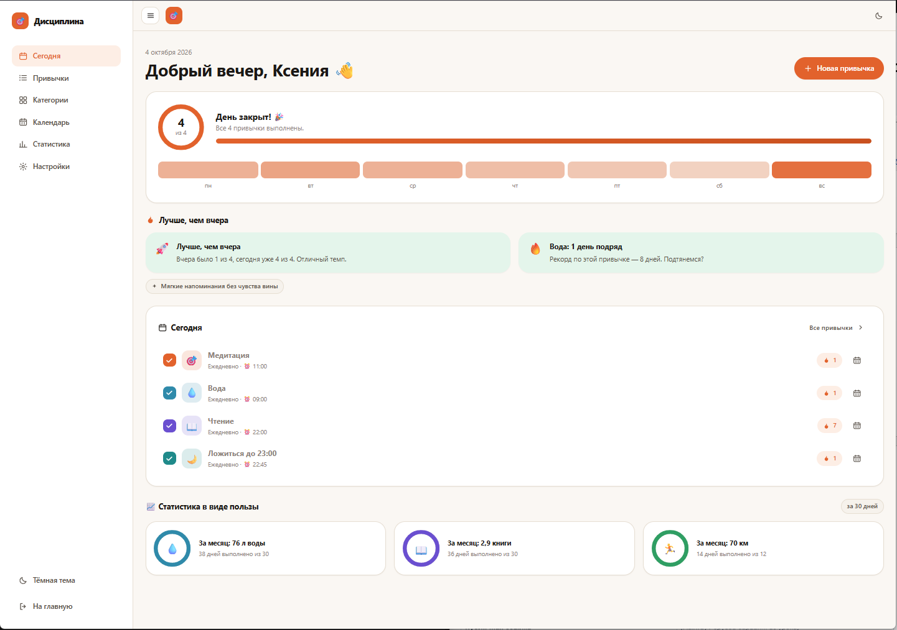
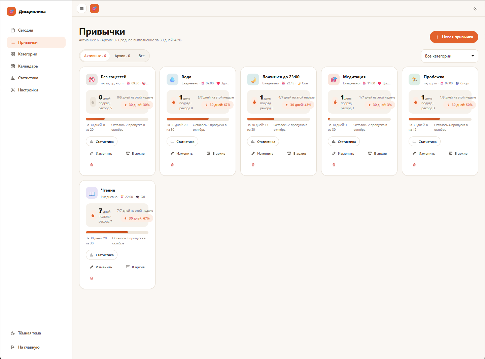
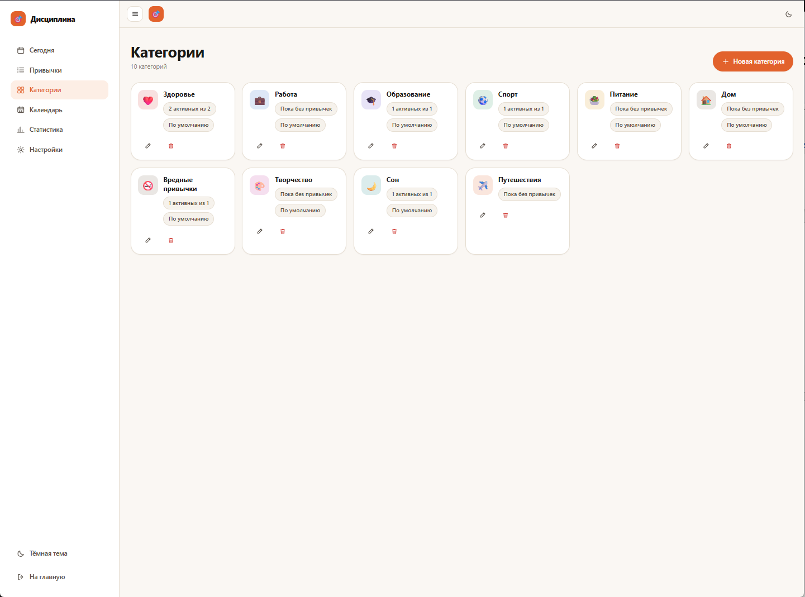
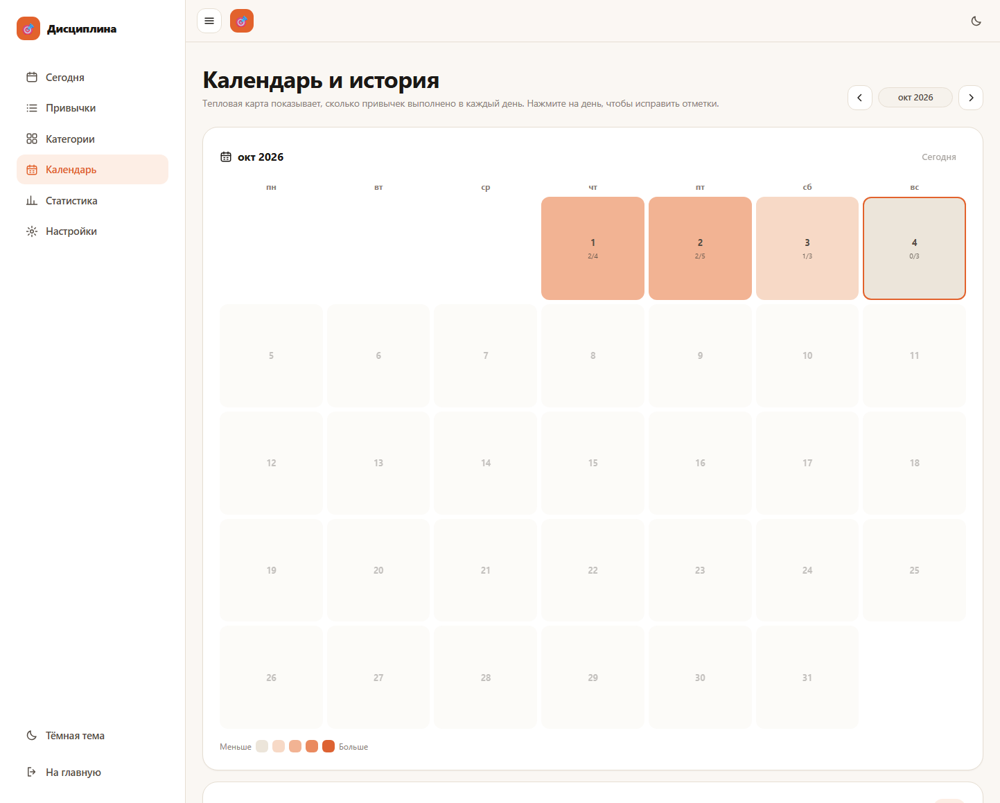
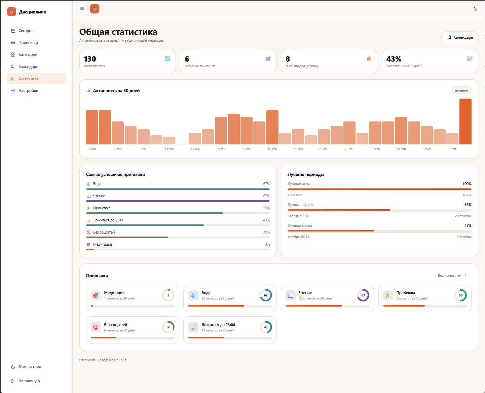
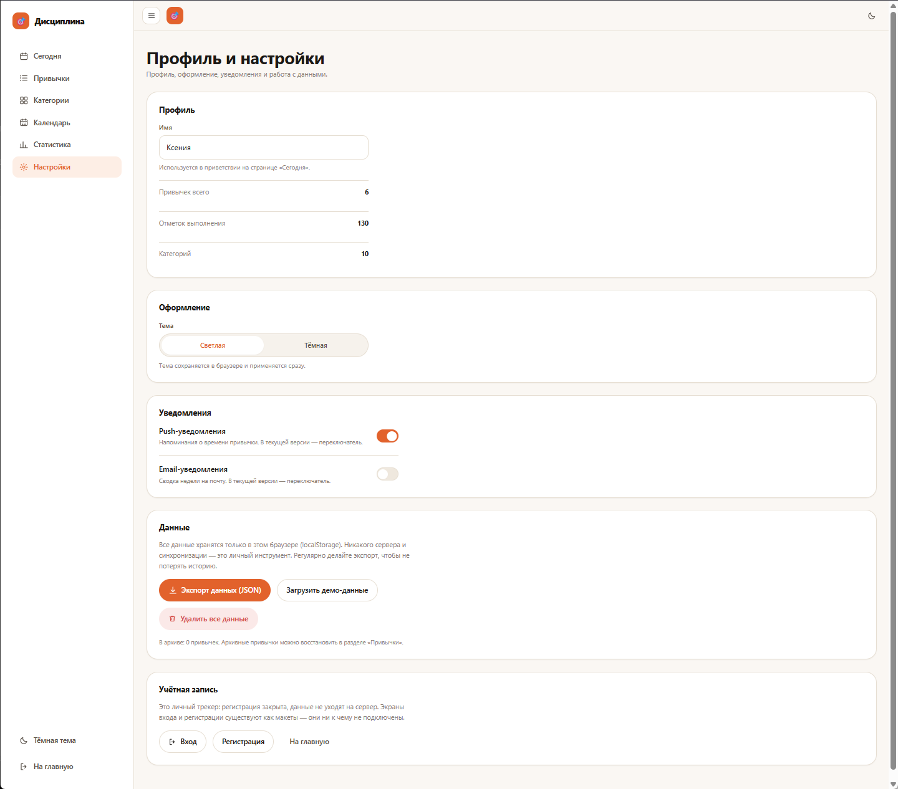

# Дисциплина — личный трекер привычек

Адаптивный веб-трекер привычек для одного пользователя: отметки за сегодня и прошлые дни, серии
выполнения, лимит пропусков, календарь с тепловой картой и статистика в понятных единицах.

**Демо:** https://kgruzdova.github.io/habit-tracker/

Полное техническое задание — в [`tz.md`](./tz.md).

## Стек

- React 19 + TypeScript
- Vite 8
- React Router 7
- oxlint, Vitest
- Хранилище — `localStorage` (без сервера и базы данных)

## Запуск

```bash
npm install
npm run dev      # http://localhost:5173
npm run build    # сборка в dist/
npm run preview  # предпросмотр сборки
npm run lint     # oxlint
npm test         # тесты логики (20 шт.)
```

При первом запуске загружаются демонстрационные данные, чтобы интерфейс не был пустым. Сбросить или
загрузить их заново можно в разделе «Настройки» («Данные»).

## Маршруты

| Маршрут | Экран |
| --- | --- |
| `/` | Лендинг-презентация |
| `/login`, `/register`, `/recover` | Вход, регистрация, восстановление пароля (макеты) |
| `/app/today` | Дашборд: прогресс, чекбоксы, мотивационные блоки |
| `/app/habits` | Все привычки: фильтр, стрики, пропуски, архив |
| `/app/habits/new`, `/app/habits/:id/edit` | Создание и редактирование привычки |
| `/app/categories` | Категории: 9 по умолчанию + CRUD |
| `/app/calendar` | Календарь с тепловой картой и правкой истории |
| `/app/stats` | Общая статистика |
| `/app/stats/:id` | Статистика привычки |
| `/app/settings` | Профиль, тема, уведомления, экспорт и удаление данных |
| `*` | 404 |

## Экраны

### Сегодня

Дашборд текущего дня: дата и приветствие, кольцо прогресса «X из N», полоса активности за неделю,
мотивационные блоки («Лучше, чем вчера», текущая серия), список привычек дня с чекбоксами и
временем напоминания, а также «статистика в виде пользы» за 30 дней (литры, страницы, минуты).



### Привычки

Все привычки карточками: переключатель «Активные / Архив / Все», фильтр по категориям, текущая
серия и рекорд, прогресс за 30 дней и остаток пропусков в месяце. Из карточки доступны переход к
статистике, редактирование, отправка в архив и удаление.



### Категории

Карточки категорий с иконкой, названием, числом активных привычек и пометкой «По умолчанию».
Категории создаются, редактируются и удаляются; привычкам назначается категория при создании.



### Календарь и история

Тепловая карта месяца: цвет дня показывает, сколько привычек выполнено, в ячейке — «выполнено из
запланированных». Навигация по месяцам, клик по дню открывает правку отметок за эту дату. Ниже —
«Итоги месяца» с прогрессом и счётчиками.



### Общая статистика

Плитки ключевых показателей (всего отметок, активных привычек, рекорд серии, выполнение за
30 дней), столбчатый график активности, «Самые успешные привычки», «Лучшие периоды» (день, неделя,
месяц) и карточки привычек с кольцами процента. У каждой привычки — отдельная страница статистики
(`/app/stats/:id`).



### Профиль и настройки

Имя (используется в приветствии) и сводные счётчики, переключение светлой/тёмной темы, тумблеры
push- и email-уведомлений (в этой версии — без реальной отправки), работа с данными: экспорт в
JSON, загрузка демо-данных, полное удаление. Раздел «Учётная запись» — макеты экранов входа и
регистрации: трекер личный, сервера нет.



### Лендинг и экраны входа

Корневой маршрут `/` — презентация продукта с переходами к входу и регистрации. `/login`,
`/register` и `/recover` — макеты форм без подключения к бэкенду (аккаунт ни к чему не привязан).

## Деплой

Каждый push в ветку `main` запускает workflow [`.github/workflows/deploy.yml`](./.github/workflows/deploy.yml):
lint → тесты → сборка → публикация на GitHub Pages. При сборке задаётся `BASE_PATH=/habit-tracker/`
(base в `vite.config.ts` и `basename` роутера), а `scripts/postbuild.mjs` кладёт копию `index.html`
в `404.html` — так прямые ссылки вида `/app/today` на Pages открывают SPA, а не ошибку.

## Структура

```
src/
  components/   UI-кит: каркас с бургер-меню, графики, модалки, иконки
  lib/          даты, периодичность, статистика, localStorage
  pages/        экраны приложения
  store/        контекст состояния (AppContext + useApp)
  index.css     дизайн-токены, светлая и тёмная темы
screenshots/    скриншоты экранов для этого README
tests/          тесты логики дат, серий и статистики
```

## Темы и адаптив

Тема переключается в настройках и в меню, сохраняется в `localStorage`. Цветовые токены — CSS-переменные
в `src/index.css`. Боковое меню сворачивается в бургер на ширине до 1000 px; раскладка рассчитана на
360 px без горизонтальной прокрутки.
